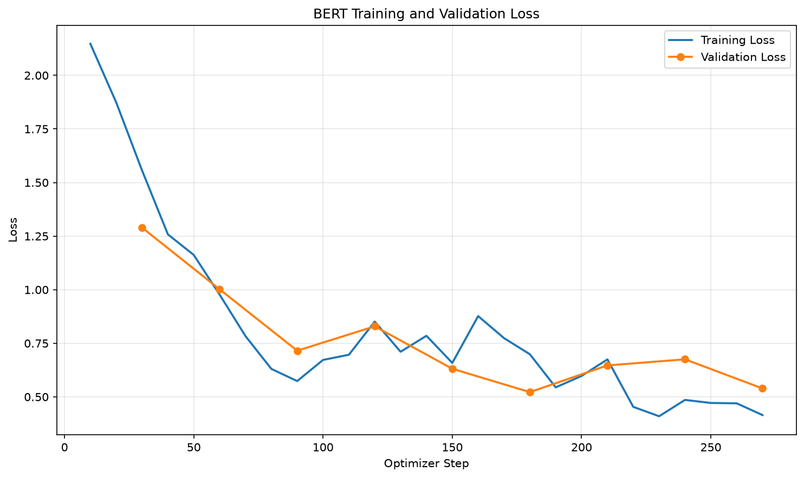
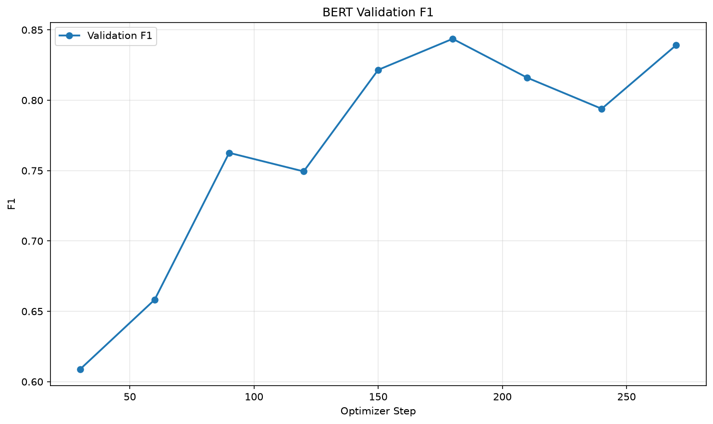

# 中文句子多元情緒分類（BERT Fine-tuning）

## 專案介紹

本專案使用預訓練的中文 BERT 模型進行微調（Fine-tuning），建立中文句子的多元情緒分類模型。

模型可以將輸入的中文句子分類為以下 8 種情緒：

1. 平淡語氣
2. 開心語調
3. 關切語調
4. 憤怒語調
5. 驚奇語調
6. 悲傷語調
7. 厭惡語調
8. 疑問語調

## 訓練資料來源

- [Chinese Multi-Emotion Dialogue Dataset](https://huggingface.co/datasets/Johnson8187/Chinese_Multi-Emotion_Dialogue_Dataset)
- 資料總數：4,159 筆
- 訓練集：3,327 筆（80%）
- 驗證集：832 筆（20%）

## 基礎模型

- [google-bert/bert-base-chinese](https://huggingface.co/google-bert/bert-base-chinese)
- 使用 Hugging Face Transformers 進行微調
- 分類類別數：8 類

## 使用套件

| 套件 | 版本 |
|---|---|
| torch | 2.2.2 |
| transformers | 4.44.2 |
| datasets | 2.21.0 |
| scikit-learn | 1.9.1 |
| numpy | 1.26.4 |
| matplotlib | 3.11.2 |
| pandas | 3.0.6 |
| accelerate | 1.15.0 |

## 模型訓練

- Epochs：最多 3
- Batch Size：8
- Gradient Accumulation Steps：2
- Learning Rate：2e-5
- Max Sequence Length：128
- Early Stopping Patience：3
- 最佳模型選擇依據：Validation Loss

## 訓練結果

- 最佳 Checkpoint：Step 180
- 最佳 Validation Loss：0.5222
- 最佳 Validation Macro F1：約 0.843
- 實際停止訓練：Step 270（Early Stopping）

### Loss 曲線



### Validation Macro F1 曲線



## 模型預測結果

使用微調後的 BERT 模型，對 5 句中文句子進行情緒分類。

| 輸入句子 | 預測情緒 | 信心分數 |
|---|---|---|
| 我每天都能跟她一起上學，我好開心！ | 開心語調 | 0.9816 |
| 最好的朋友要離開臺灣了，以後可能不容易再見面... | 悲傷語調 | 0.9514 |
| 我覺得我快不行了... | 悲傷語調 | 0.9353 |
| 剛剛收到研究所錄取的通知書！ | 開心語調 | 0.9209 |
| 今年的冬天好像比較晚來。 | 平淡語氣 | 0.9738 |

註：信心分數為模型對預測類別的估計機率，
不代表模型整體準確率。

## 執行方法

依序執行：

```bash
python prepare_data.py
python train_bert.py
python plot_bert_metrics.py
python infer_bert.py
```

若已經有訓練好的模型，可以直接執行：

```bash
python infer_bert.py
```

## 專案檔案說明

| 檔案 | 功能 |
|---|---|
| prepare_data.py | 資料前處理與訓練、驗證集切分 |
| train_bert.py | BERT 模型微調 |
| plot_bert_metrics.py | 繪製 Loss 與 F1 曲線 |
| infer_bert.py | 載入最佳模型並預測句子情緒 |
| output/ | 儲存微調後的最佳模型 |
| images/ | 儲存訓練成果圖表 |
